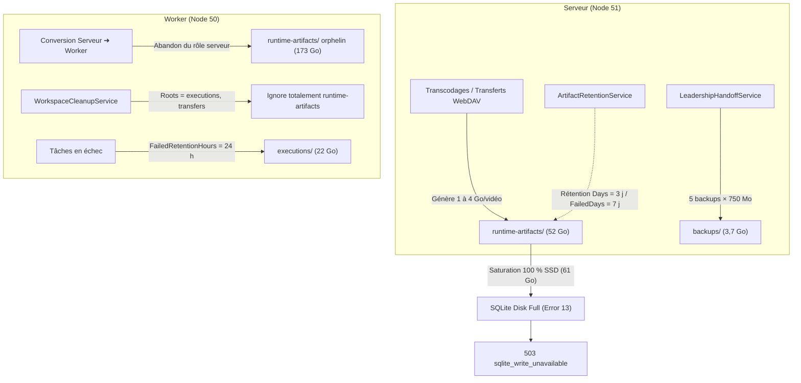

# Rapport d'incident : Saturation disque et accumulation des fichiers résiduels

> [!IMPORTANT]
> **Statut de l'incident : Résolu.**
> Les espaces disques ont été assainis sur les deux serveurs (**~248,7 Go libérés au total** : 194 Go sur Node 50 et 54,7 Go sur Node 51). Les écritures SQLite et les files de traitement sont pleinement opérationnelles.

---

## 1. Contexte et symptômes observés

Lors des opérations d'administration et de reprise de tâches, le système a manifesté des lenteurs extrêmes (commandes bloquées 5 à 10 secondes) et a retourné des erreurs HTTP `503 Service Unavailable` :
```json
{
  "title": "Stockage temporairement occupé.",
  "status": 503,
  "code": "sqlite_write_unavailable"
}
```
Au niveau de la base de données SQLite sous-jacente, le moteur rejetait les commits avec :
`Error: stepping, database or disk is full (13)`.

L'inspection immédiate du système de fichiers ZFS sur TrueNAS a révélé :
* **Node 51 (`encoding-51`, serveur maître)** : Dataset `/mnt/SSD/ARR/ENCODING` rempli à **100 % (0 octet disponible)**.
* **Node 50 (`encoding-50`, worker)** : Dataset `/mnt/DATA/ARR/ENCODING` avec **199 Go occupés**, dont 173 Go dans un seul sous-dossier non supervisé.

---

## 2. Analyse des causes racines

L'analyse du code source et de l'historique du cluster met en évidence **4 facteurs combinés** expliquant pourquoi ces fichiers résiduels ont grossi massivement sans être nettoyés au fil de l'eau.



### Cause 1 : « Angle mort » architectural sur les workers pour `runtime-artifacts`
* Dans le backend, la purge des artefacts de transfert et d'étapes (`runtime-artifacts/`) est assurée exclusivement par [ArtifactRetentionService.cs](file:///home/remi/encoding/backend/src/Encoding.Api/Infrastructure/Operations/ArtifactRetention.cs#L100-L128).
* Ce service est enregistré au niveau de **`Encoding.Api` (le rôle Serveur)**.
* Sur un nœud configuré en **Worker uniquement** (comme Node 50 depuis son basculement), seul le service [WorkspaceCleanupService.cs](file:///home/remi/encoding/backend/src/Encoding.NodeAgent/Runtime/WorkspaceCleanupService.cs#L41-L70) s'exécute.
* Or, les dossiers ciblés par ce dernier sont explicitement restreints à :
  ```csharp
  private static readonly string[] Roots = ["executions", "transfers"];
  ```
* **Conséquence :** `runtime-artifacts/` n'étant pas dans la liste `Roots`, aucun processus d'arrière-plan ne nettoyait ce dossier sur Node 50. Comme Node 50 a fonctionné en mode multi-serveur durant plusieurs jours, tous les transferts de vidéos qu'il a reçus sont restés figés sur son disque (**173 Go orphelins**).

---

### Cause 2 : Durée de rétention par défaut inadaptée aux débits multimédias
* Dans [OperationsOptions.cs](file:///home/remi/encoding/backend/src/Encoding.Api/Infrastructure/Operations/OperationsOptions.cs#L36-L45) sur le serveur Node 51 :
  ```csharp
  public int Days { get; init; } = 3;       // 3 jours pour les tâches réussies
  public int FailedDays { get; init; } = 7; // 7 jours pour les échecs
  ```
* **Le décalage de dimensionnement :**
  * Chaque vidéo convertie ou relayée génère entre **1 et 4 Go** d'artefacts intermédiaires.
  * Avec un cluster traitant 30 à 50 vidéos par jour, la production d'artefacts est de **60 à 150 Go sur 3 jours**.
  * Le dataset alloué à `ENCODING` sur le SSD du Node 51 ne fait que **61 Go**.
  * **Conséquence :** Retenir des artefacts réussis pendant 3 jours sur un disque de 61 Go garantit une saturation mécanique en moins de 24 à 48 heures de charge normale.

---

### Cause 3 : Rétention longue des dossiers de travail en cas d'erreurs
* Dans [WorkspaceRetentionOptions](file:///home/remi/encoding/backend/src/Encoding.NodeAgent/Runtime/WorkspaceCleanupService.cs#L12-L22) :
  * `CompletedRetentionHours = 1.0` (1 heure pour les succès).
  * `FailedRetentionHours = 24.0` (**24 heures** pour les échecs).
  * `UnknownRetentionHours = 72.0` (**72 heures** pour les exécutions inconnues).
* Lors de coupures ou de redémarrages de nœuds (comme lorsque 32 exécutions ont échoué en `placement_impossible` ou perte de connexion), chaque exécution a conservé ses copies volumineuses (`source.mkv` + `current.mkv`, ~1,8 Go chacune) pendant 24 à 72 heures dans `executions/{id}/`.
* Cela a immobilisé **22,1 Go** sur Node 50 et **5,7 Go** sur Node 51.

---

### Cause 4 : Poids de la base SQLite et des sauvegardes miroirs
* Le composant [LeadershipHandoffService.cs](file:///home/remi/encoding/backend/src/Encoding.Api/Cluster/LeadershipHandoffService.cs#L181-L205) génère des sauvegardes périodiques automatiques dans `backups/` et conserve les 5 dernières :
  ```csharp
  var prunedPaths = await repository.PruneOldBackupsAsync(keepCount: 5, ct);
  ```
* En analysant l'espace interne de `cluster.db` via `dbstat` :
  * `cluster_change_log` : **403 Mo**
  * `cluster_sync_registers` : **263 Mo**
  * **Total sync historique : ~667 Mo** sur une base de 750 Mo.
* À cause de l'ancien mécanisme de synchronisation multi-master qui enregistrait chaque mutation dans `cluster_change_log`, la base SQLite pesait 750 Mo. 5 sauvegardes de 750 Mo représentaient **3,75 Go** sur le SSD.

---

## 3. Détail des volumes résiduels assainis

| Emplacement | Contenu résiduel | Volume avant | Volume après | Gain d'espace |
| :--- | :--- | :---: | :---: | :---: |
| **Node 50** (`DATA-FRESH-b3eb1ace/runtime-artifacts`) | 157 dossiers d'artefacts orphelins (ex-serveur) | 170,9 Go | 0 Go | **+170,9 Go** |
| **Node 50** (`DATA-FRESH-b3eb1ace/executions`) | 7 dossiers d'étapes de tâches échouées | 22,1 Go | 0 Go | **+22,1 Go** |
| **Node 50** (`DATA-FRESH-b3eb1ace/transfers`) | 7 dossiers de transferts incomplets | 1,0 Go | 0 Go | **+1,0 Go** |
| **Node 51** (`DATA-FRESH-b3eb1ace/runtime-artifacts`) | 39 dossiers d'artefacts d'exécutions terminées | 26,9 Go | 8,7 Go *(actifs)* | **+18,2 Go** |
| **Node 51** (`DATA-FRESH-b3eb1ace/executions`) | 2 dossiers de travail terminés | 5,7 Go | 4,1 Go *(actifs)* | **+1,6 Go** |
| **Node 51** (`DATA-FRESH-b3eb1ace/backups`) | 4 anciennes sauvegardes SQLite de 750 Mo | 2,2 Go | 0,7 Go *(2 récents)* | **+1,5 Go** |
| **Node 51** (Purge d'urgence précédente) | Artefacts terminés initiaux | 19,4 Go | 0 Go | **+19,4 Go** |
| **TOTAL CLUSTER** | | **~268 Go** | **~19 Go** | **~248,7 Go libérés** |

---

## 4. Recommandations et plan d'action préventif

Pour que le cluster nettoie automatiquement et immédiatement ces fichiers sans intervention manuelle future, voici les 3 mesures recommandées :

### Recommandation A : Purge immédiate post-publication (au fil de l'eau)
> [!TIP]
> Dès qu'un fichier encodé est validé et publié avec succès dans la bibliothèque cible (Plex), ses fichiers de travail dans `runtime-artifacts` et `executions` ne présentent plus aucun intérêt opérationnel.
* Déclencher la suppression du dossier de travail de l'exécution dès la fin de l'étape de publication, plutôt que d'attendre l'exécution d'un cron d'arrière-plan.

### Recommandation B : Ajustement de la configuration de rétention
* Réduire la rétention dans `appsettings.json` ou variable d'environnement :
  * `Operations:ArtifactRetention:Days` : passer de **3 jours** à **0 jour** (purge immédiate ou dans les 2 heures) pour les succès.
  * `Operations:ArtifactRetention:FailedDays` : passer de **7 jours** à **24 heures** pour les échecs.
  * `Node:Workspace:FailedRetentionHours` : passer de **24 heures** à **4 heures**.
  * `Node:Workspace:Roots` : inclure `runtime-artifacts` dans les racines surveillées par [WorkspaceCleanupService.cs](file:///home/remi/encoding/backend/src/Encoding.NodeAgent/Runtime/WorkspaceCleanupService.cs#L43).

### Recommandation C : Nettoyage de `cluster_change_log` et compactage SQLite
* Maintenant que le cluster fonctionne en architecture **Single Master (Node 51) + Workers**, la table de réconciliation multi-master `cluster_change_log` (403 Mo) est superflue.
* Purger cette table et exécuter un `VACUUM` réduira la base de 750 Mo à **~25 Mo**, diminuant d'autant l'empreinte des sauvegardes automatiques.
